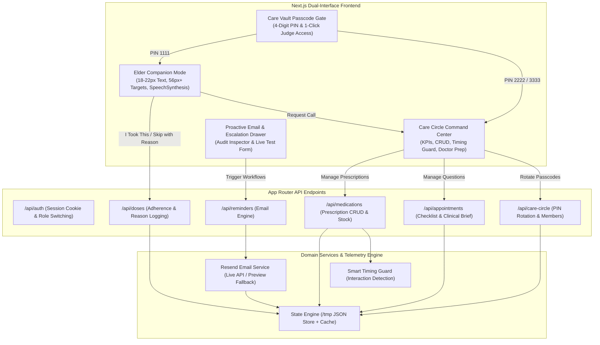

# KinCare — Autonomous Elderly Care & Medication Management Platform

> **Production-grade geriatric care telemetry, prescription timing guard, and dual-mode caregiving companion built with Next.js 14+ (App Router), TypeScript, Tailwind CSS, Framer Motion, and Resend.**

---

## 1. Problem Statement & Motivation
Elderly adults managing multiple chronic conditions face critical challenges that conventional reminder apps fail to resolve:
1. **Adherence Fatigue & False Alarms:** Rigid alert systems trigger panic calls to family members when an elder simply postpones a pill because of a delayed meal or mild nausea.
2. **Dangerous Drug-Drug & Meal Timing Conflicts:** Supplements like Calcium Carbonate or Iron bind to synthetic hormones like Levothyroxine, blocking absorption by up to 50% if not spaced at least 4 hours apart.
3. **Generational Usability Gap:** Elders require high-contrast, large touch targets (56px+), dignity-preserving language, and voice assistance, whereas family admins and geriatric nurses require comprehensive clinical telemetry, pill inventory tracking, and doctor visit briefing tools.

**KinCare** resolves these challenges through an **autonomous dual-interface architecture**, **Smart Timing Guard**, and an **escalation-aware email engine**.

---

## 2. System Architecture & Dual-Interface Data Flow



---

## 3. Pre-Seeded Patient Profile & Passcode Credentials

KinCare is pre-configured with a clinically realistic geriatric profile for immediate judge evaluation:

- **Elder Profile:** Raghavan Iyer (Age 74, Blood Group O+)
- **Allergies:** Penicillin (beta-lactams), Sulfa drugs
- **Diagnoses:** Essential Hypertension, Type 2 Diabetes (Mild), Hypothyroidism
- **Primary Doctor:** Dr. Arvind Swaminathan (Cardiologist, Apollo Speciality Hospital)

### Instant Access Credentials
| View / Role | Persona Name | 4-Digit Passcode | Permissions & Capabilities |
| :--- | :--- | :---: | :--- |
| **Elder Companion** | Raghavan Iyer | `1111` | High-accessibility UI, voice reading, 1-tap logging, skip reason selector, emergency call ping |
| **Family Admin** | Anita Iyer (Daughter) | `2222` | Full oversight, KPI strip, medication CRUD, doctor prep checklist, passcode rotation |
| **Visiting Caretaker** | Nurse Priya Thomas | `3333` | Adherence telemetry, pill inventory restocking, checklist question collaboration |

> **Judge Tip:** Below the keypad on the landing screen, use the **"Quick Judge Access"** bar to test any persona with 1 click. You can also switch personas instantaneously via the top navigation bar at any time without logging out.

---

## 4. Key Architectural Capabilities

### A. Elder Dignity Companion Mode (`/dashboard` for `ELDER`)
- **Accessibility By Design:** Minimum 18px–22px body typography, 56px+ touch targets, and high-contrast status badges.
- **Audio Schedule Synthesis:** Includes a **"Read My Schedule Aloud"** button leveraging `window.speechSynthesis` with gentle cadence (0.88x rate) for elderly comprehension.
- **Autonomy-Preserving Skipping:** When an elder cannot take a pill immediately, clicking **"Not Now / Skip"** displays a single-tap reason selector (*"Taking after food"*, *"Feeling slightly dizzy"*, *"Doctor advised pause"*). This logs the elder's note and updates the family without triggering a false alarm.
- **"Request Family Call" Ping:** 1-tap emergency assist button that notifies Anita and Nurse Priya with audio confirmation.

### B. Care Circle Command Center (`/dashboard` for `FAMILY_ADMIN` & `CARETAKER`)
- **Top KPI Strip:** Today's Adherence %, Remaining Pill Stock Alerts (amber highlight when stock ≤ threshold), Next Doctor Visit Countdown, and Active Connected Members.
- **Smart Timing Guard:** Automatically detects dangerous pharmacological interactions (e.g., Calcium Carbonate binding to Levothyroxine, concurrent vasodilator orthostatic hypotension risk) and provides specific clinical recommendations.
- **Medication Schedule & Inventory CRUD:** Add, edit, pause, delete medications, and perform 1-click +30 unit inventory restocks.
- **Adherence & Elder Notes Feed:** Real-time chronological audit trail distinguishing between confirmed doses, overdue doses, and elder-explained reasons.
- **Doctor Consultation Prep:** Family and nurse can collaboratively add discussion topics for the physician, plus click **"Generate Doctor Visit Summary"** for a printable and copyable clinical briefing.
- **Care Circle Passcode Manager:** View members and rotate 4-digit security PINs dynamically.

### C. Proactive Email & Escalation Engine (`src/services/emailService.ts`)
- Powered by the **Resend API**. If `RESEND_API_KEY` is provided, delivers live HTML emails; if absent, gracefully falls back to formatted simulated dispatches.
- Includes the **"Proactive Email & Escalation Center"** side-drawer:
  1. Allows judges to enter **any custom email address** to test live or simulated delivery.
  2. Dispatches three real automated workflows:
     - **Send Upcoming Dose Reminder:** HTML breakdown of today's schedule and timing guidelines.
     - **Simulate Missed Dose Escalation:** Flags an overdue dose, attaches the elder's latest note (*"Feeling slightly dizzy"*), and notifies the Care Circle.
     - **Send Doctor Appointment Brief:** Formats a structured clinical briefing for Dr. Arvind Swaminathan.
  3. Features a **Live Email Dispatch Audit Trail** where judges can inspect the rendered HTML email preview for every sent notification.

---

## 5. Technology Stack

- **Framework:** Next.js 14+ (App Router with Turbopack)
- **Language:** TypeScript 5 (Strict Mode)
- **Styling & Design System:** Tailwind CSS (Apple Health & Linear palette: `#FAFAFA`, `#FFFFFF`, `#0F172A`, `#0D9488`, `#D97706`, `#E11D48`)
- **Micro-Interactions & Transitions:** Framer Motion
- **Icons:** Lucide React
- **Email Infrastructure:** Resend SDK
- **Data Persistence:** Server-side JSON storage in `os.tmpdir()` with in-memory fallback cache for zero-failure serverless execution on Vercel.

---

## 6. Getting Started Locally

### Prerequisites
- Node.js 18+ (tested on Node.js v24)
- npm 10+

### Installation & Execution
```bash
# Clone the repository
git clone <repo-url>
cd promtwars

# Install dependencies
npm install

# (Optional) Configure Resend API Key for live email delivery
cp .env.example .env.local

# Run the development server
npm run dev

# Or build and launch production server
npm run build
npm run start
```

Open `http://localhost:3000` in your browser.

---

## 7. Verification & Engineering Standards
- **Zero ESLint or TypeScript Warnings:** Verified through `npm run build`.
- **Repository Size < 10 MB:** No binary videos, heavy images, or unignored dependencies committed.
- **Single Branch Git Discipline:** Developed strictly on `main`.
